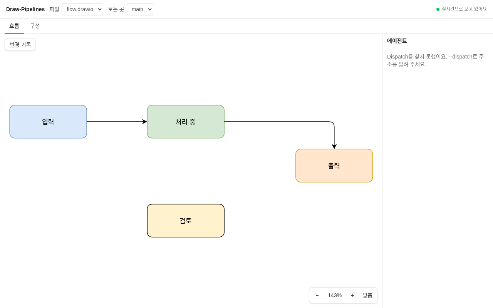
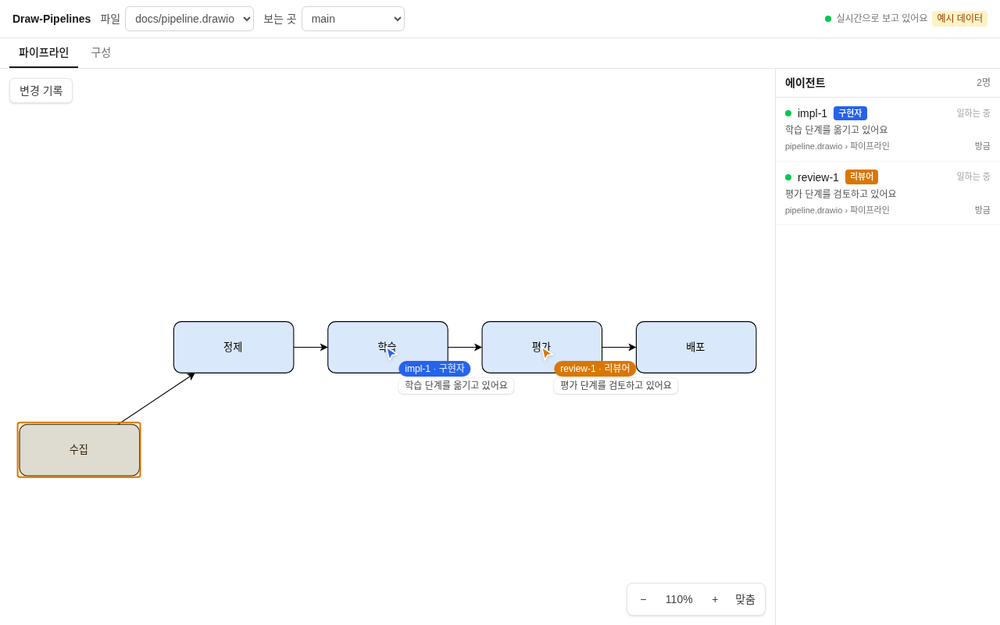
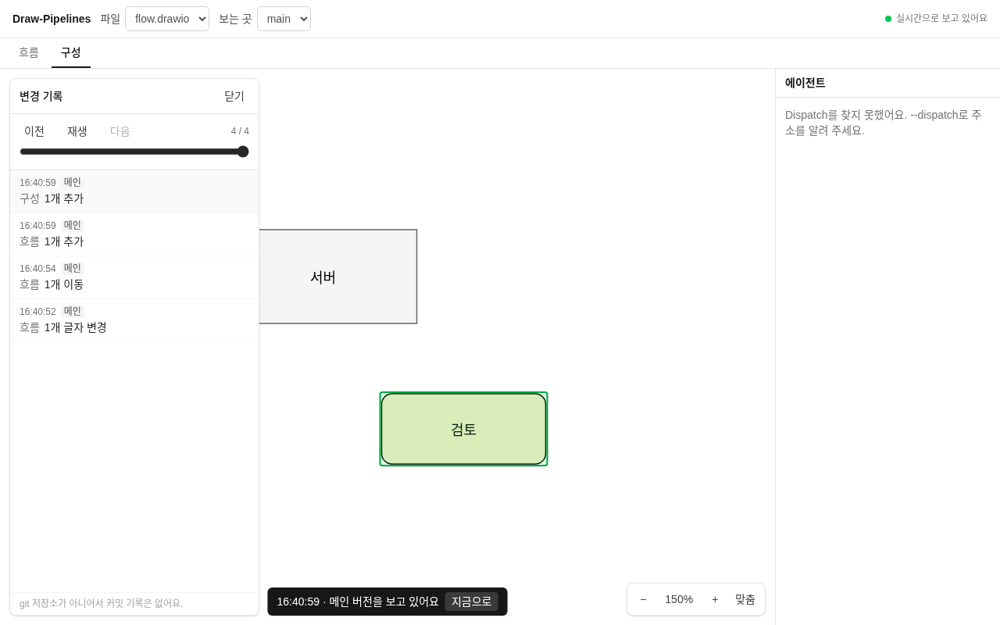

# Draw-Pipelines

draw.io 파일이 바뀌는 모습을 웹에서 바로 보여 주고, 그 파일을 고치는 AI 에이전트(Dispatch 세션)가 어느 워크트리에서 무엇을 하는지 함께 보여 주는 로컬 웹 페이지예요.



## 시작하기

필요한 것: Node.js 22 이상

1. 저장소를 받고 의존성을 설치해요.
   ```
   npm install
   npm run build
   ```
2. draw.io 파일이 있는 폴더를 지정해서 서버를 켜요.
   ```
   npm start -- <project-dir>
   ```
3. 터미널에 나온 주소를 브라우저로 열어요. 기본 주소는 `http://127.0.0.1:4330/` 예요.

`npm run build` 를 건너뛰면 서버는 켜지지만 페이지 대신 "Web app not built" 메시지가 나와요.

## 실행 옵션

| 설정 | 설명 |
|---|---|
| `<project-dir>` | 감시할 폴더. 필수예요. `*.drawio`, `*.drawio.xml` 파일을 하위 폴더까지 찾아요. |
| `DRAW_PORT` | 포트 번호. 생략하면 4330 을 써요. 예: `DRAW_PORT=4340 npm start -- <project-dir>` |
| `--dispatch <url>` | Dispatch 서버 주소. 생략하면 프로젝트의 `.dispatch/server.port` 를 읽어요. 예: `--dispatch http://127.0.0.1:4318` |

포트가 이미 쓰이고 있으면 서버가 바로 종료되고, 다른 포트를 고르라는 메시지를 보여 줘요.

## 안전 원칙

- **127.0.0.1 전용이에요.** 같은 컴퓨터에서만 접속할 수 있어요. 다른 기기에서는 열리지 않아요.
- **읽기 전용이에요.** 감시하는 draw.io 파일을 쓰지 않아요. Dispatch 에는 GET 요청만 보내고, 메시지를 보내거나 상태를 바꾸지 않아요.
- **인증과 원격 접속은 없어요.** 지금 범위 밖이에요.

## 다이어그램 보기

- 파일, 페이지, 소스(main 또는 작업 중인 워크트리)를 골라 봐요.
- 확대·축소, 이동, 화면 맞춤을 할 수 있어요.
- 파일이 바뀌면 화면을 새로고침하지 않고 바로 반영해요. 확대 위치는 그대로 유지돼요.
- 바뀐 셀은 잠깐 색으로 표시해요. 추가는 초록, 변경은 주황, 삭제는 빨간 흔적으로 보여요.
- 렌더링은 draw.io 공식 뷰어(diagrams.net, v32.6.10)를 프로젝트에 같이 넣어서 써요. 인터넷 없이도 동작해요.

## 에이전트 귀속 방식

어떤 에이전트가 어느 파일을 고쳤는지 이렇게 찾아요.

1. Dispatch 서버의 `GET /api/state` 로 세션 목록을 읽고, `GET /api/events` 로 변경을 받아요. 세션 이름, 역할, 상태, 브랜치, 작업 폴더만 써요.
2. 세션의 작업 폴더를 워크트리 폴더(`.dispatch/wt/<이름>/`)에 연결해요. 세션의 cwd, `worktree` 필드, `dispatch/<이름>` 브랜치 순서로 확인해요.
3. 파일이 바뀌면 같은 파일의 이전 버전과 셀 단위로 비교해요. 추가, 삭제, 위치 이동, 글자 변경, 스타일 변경을 구분해요.
4. 그 파일이 있는 워크트리 폴더를 보고 에이전트를 찾아요. 폴더가 겹치면 더 깊은 폴더가 이겨요. 같은 폴더를 여러 세션이 쓰고 둘 다 살아 있거나 둘 다 끝났으면 귀속하지 않아요.
5. Dispatch 가 꺼져 있어도 파일 감시는 계속돼요. Dispatch 가 다시 켜지면 자동으로 연결해요.

워크트리 안의 수정은 머지 전에도 보여요. 세션 이름을 못 찾으면 폴더 이름을 써요.

## 라이브 커서

에이전트가 일하는 곳에 커서가 떠 있어요. 지금 보고 있는 페이지에서 일하는 에이전트만 커서로 보여 줘요.



- 에이전트마다 커서 하나가 있어요. 색은 역할별로 다르고, 이름표에는 "이름 · 역할"과 활동 한 줄이 같이 나와요.
- 커서는 바뀐 영역의 가운데를 가리켜요.
- 커서는 스프링처럼 부드럽게 움직여요. 여러 변화가 한꺼번에 와도 튀지 않아요. 화면을 확대하거나 옮겨도 커서가 다이어그램에서 떨어지지 않아요.
- 한동안(1분) 변화가 없으면 커서가 흐려지고, 5분이 지나면 사라져요.
- 다른 페이지에서 일하는 에이전트는 커서 대신 그 페이지 탭 옆에 작은 칩으로 보여요.
- 오른쪽 에이전트 패널에는 상태 점, 활동 한 줄, 파일과 페이지, 마지막 변경 뒤 시간이 나와요. 일하는 에이전트가 위에 와요. 항목을 누르면 그 에이전트의 페이지로 가서 커서를 보여 줘요.
- Dispatch 가 없어도 볼 수 있어요. 주소 뒤에 `?mock` 을 붙이면(예: `http://127.0.0.1:4330/?mock`) 예시 데이터로 움직이는 커서를 볼 수 있어요.

## 변경 기록

파일이 어떻게 바뀌어 왔는지 시간순으로 볼 수 있어요.



- 화면 왼쪽 위의 **변경 기록** 버튼을 누르면 패널이 열려요. 최신 변경이 위에 와요.
- 각 항목에는 시간, 누가 바꿨는지(main 또는 워크트리와 에이전트), 페이지, 한 줄 요약(예: "1개 추가")이 있어요.
- 항목을 누르면 그때의 페이지를 보여 주고, 바뀐 셀을 색으로 표시해요. 이때 화면 위쪽에 "과거 버전" 안내가 나와요. **지금으로** 를 누르면 실시간 화면으로 돌아가요.
- 아래 슬라이더와 **이전**, **재생**, **다음** 버튼으로 변경을 순서대로 되감거나 재생해요. 재생은 한 단계에 약 1초예요.
- 파일이 git 저장소에 있으면 그 파일의 커밋 제목도 같은 목록에 나와요. git 저장소가 아니면 커밋은 나오지 않아요.
- 파일마다 최근 500개 변경을 기록해요. 메모리를 많이 쓰면 오래된 버전부터 내용을 지워요. 항목은 남지만 "오래돼서 내용은 지워졌어요"라고 표시하고 그 버전은 열 수 없어요.
- 기록은 메모리에만 있어서 서버를 끄면 사라져요.

## 감지 방식

- 0.25초마다 파일의 수정 시각과 크기를 확인해요.
- 파일이 300ms 동안 조용해지면 한 번의 변경으로 묶어 처리해요. 스크립트가 여러 번 나눠 써도 변경 한 번으로 봐요.
- 3초마다 폴더를 다시 훑어서 새 파일과 지워진 파일을 찾아요.
- 한 파일당 최근 500개 변경을 메모리에 보관해요. 서버를 끄면 사라져요.
- 20MB 를 넘는 파일은 읽지 않아요.

## 개인정보

- 대화 내용, 토큰, API 키, 이메일, 실명을 저장하지도 기록하지도 않아요.
- 에이전트 정보는 이름, 역할, 상태, 활동 한 줄(최대 140자), 바뀐 파일과 셀만 메모리에 둬요.
- 이 프로젝트는 파일을 디스크에 쓰지 않아요.
- `.env` 파일은 읽지 않아요.

## 개발

| 명령 | 설명 |
|---|---|
| `npm test` | 서버와 웹 로직 테스트 |
| `npm run build` | 웹 빌드. `public/` 에 결과물을 만들어요. |
| `npm run dev:web` | 웹 개발 서버 |

작업 목록과 설계 결정은 [docs/tickets.md](docs/tickets.md) 와 [docs/decisions/](docs/decisions/) 에 있어요.

## 서드파티

draw.io 뷰어 `viewer-static.min.js`(Apache-2.0)를 수정하지 않고 넣었어요. 이 파일이 포함한 서드파티 코드 목록은 [web/static/vendor/drawio/THIRD_PARTY.md](web/static/vendor/drawio/THIRD_PARTY.md) 에 있어요.
