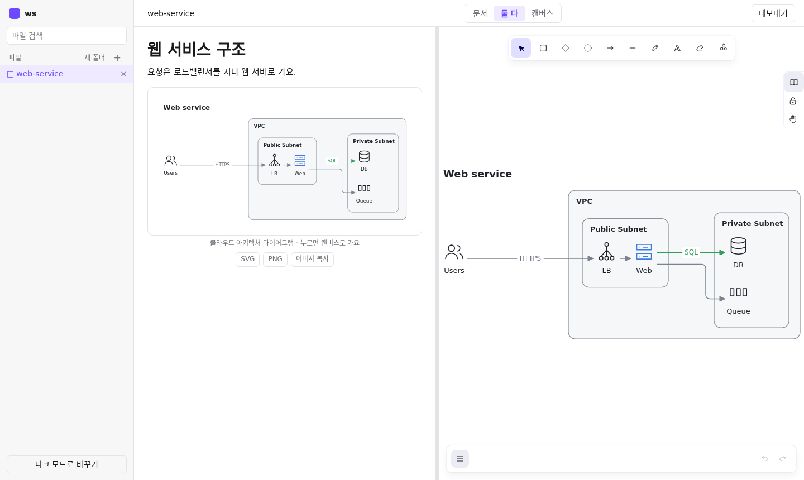
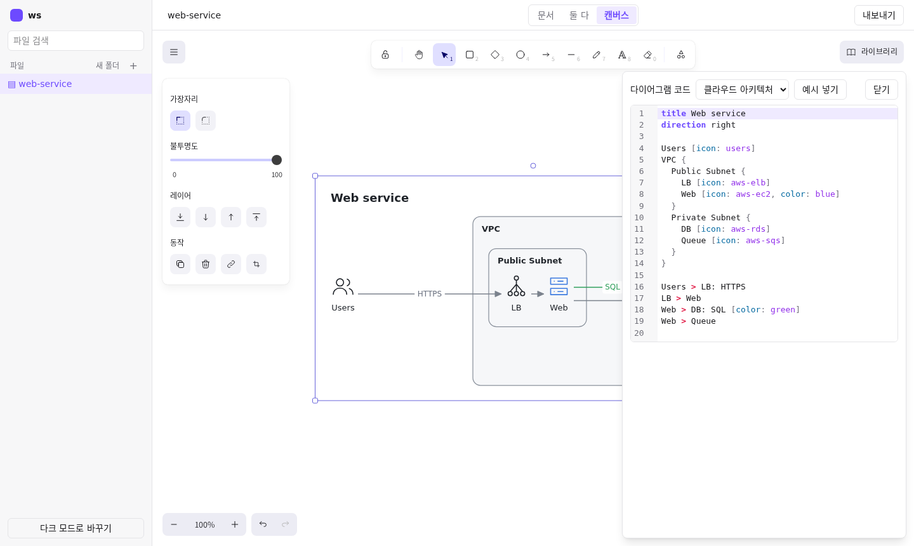

# Drawing

문서와 무한 캔버스를 파일 하나에 담는, 로컬 전용 다이어그램 도구예요. 글을 쓰다가 `/` 로 다이어그램을 넣고, 코드로 그린 그림을 캔버스에서 자유롭게 손볼 수 있어요.

- 파일 하나에 문서와 캔버스가 함께 들어 있어요. (`*.dpx.json`)
- 다이어그램은 코드로 써요. 아키텍처, 플로우차트, 시퀀스, ERD를 지원해요.
- 캔버스에서는 도형, 화살표, 손그림을 자유롭게 그려요.
- SVG, PNG, Markdown으로 내보내요.
- 내 컴퓨터의 폴더 하나가 작업 공간이에요. 서버는 그 폴더 안에서만 읽고 써요.



## 설치와 실행

필요한 것: Node.js 22.18 이상

```
npm install
npm run build
npm start -- <작업 폴더>
```

터미널에 나온 주소(기본 `http://127.0.0.1:4330/`)를 브라우저로 열어요. `<작업 폴더>` 는 미리 만들어 둔 폴더여야 해요.

| 설정 | 설명 |
|---|---|
| `<작업 폴더>` | 파일이 저장되는 폴더. 필수예요. |
| `DRAW_PORT` | 포트 번호. 생략하면 4330. 예: `DRAW_PORT=4340 npm start -- <작업 폴더>` |

- `npm run build` 를 건너뛰면 서버는 켜지지만 페이지 대신 "Web app not built" 메시지가 나와요.
- 포트가 이미 쓰이고 있으면 서버가 바로 종료되고 다른 포트를 고르라는 메시지를 보여 줘요.

## 쓰는 법

1. 왼쪽 사이드바의 `+` 로 파일을 만들어요. 폴더는 `새 폴더` 로 만들어요.
2. 문서에서 `/` 를 누르고 `새 다이어그램` 을 골라요. 같은 그림이 캔버스에도 생겨요.
3. 캔버스에서 다이어그램을 더블클릭하면 코드 편집기가 열려요. 코드를 고치면 그림이 바로 바뀌고, 문법 오류는 줄에 표시돼요.
4. 위쪽의 `문서` / `둘 다` / `캔버스` 로 보기를 바꿔요. 변경은 자동으로 저장돼요.
5. `내보내기` (Ctrl+E, Mac은 ⌘E) 에서 SVG, PNG, Markdown을 골라요.



## 다이어그램 코드 치트시트

종류는 코드 모양을 보고 자동으로 정하고, 편집기 위쪽 목록에서 직접 고를 수도 있어요. 아래 예시는 모두 앱에서 그대로 읽혀요. (`test/dsl/fixtures/` 에 같은 코드가 있고 `npm test` 가 확인해요.)

공통 문법:

| 문법 | 뜻 |
|---|---|
| `Name [icon: aws-ec2, color: blue]` | 노드와 속성. 주요 속성은 `icon`, `color`, `label`, `shape` |
| `Group { ... }` | 그룹. 안에 그룹을 또 넣을 수 있어요 |
| `A > B`, `A < B`, `A <> B`, `A - B`, `A -- B`, `A --> B` | 연결. `A > B > C` 처럼 이어 쓸 수 있어요 |
| `A > B: 라벨 [color: red]` | 연결 라벨과 속성 |
| `title`, `direction right` | 제목, 방향 |
| `// 설명` | 주석 |

### 클라우드 아키텍처

```
title Web service
direction right

Users [icon: users]
VPC {
  Public Subnet {
    LB [icon: aws-elb]
    Web [icon: aws-ec2, color: blue]
  }
  Private Subnet {
    DB [icon: aws-rds]
    Queue [icon: aws-sqs]
  }
}

Users > LB: HTTPS
LB > Web
Web > DB: SQL [color: green]
Web > Queue
```

### 플로우차트

```
title Ticket workflow
direction right

Start [shape: oval, color: green]
Triage [icon: flag]
Valid? [shape: diamond]
Fix [color: blue]
Done [shape: oval]

Start > Triage > Valid?
Valid? > Fix: yes
Valid? > Done: no [color: red]
Fix > Done
```

### 시퀀스

```
title Login
autoNumber on
order Client, API, DB

Client [icon: monitor] > API [icon: server]: POST /login
activate API
API > DB [icon: database]: find user
DB > API: row
alt [label: valid] {
  API > Client: token
}
else [label: invalid] {
  API > Client: 401 [color: red]
}
deactivate API
```

### ERD

```
title Billing
notation crows-foot

users [icon: user, color: blue] {
  id string pk
  email string unique not null
  teamId string
}
teams [icon: users] {
  id string pk
  name string
}
products {
  id int pk
  format "enum(DVD, Blu-ray)"
  price decimal(10,2)
}

users.teamId > teams.id: [color: green]
```

## 단축키

Mac에서는 Ctrl 대신 ⌘ 을 써요. `Ctrl/⌘+K` 로 여는 명령 팔레트에서도 같은 동작을 찾을 수 있어요.

어디서나 쓰는 키 (내보내기와 복사는 파일을 연 상태에서, 글을 쓰는 중이 아닐 때):

| 키 | 동작 |
|---|---|
| Ctrl/⌘+K | 명령 팔레트 |
| Ctrl/⌘+E | 내보내기 메뉴 (창 너비 768px 이상) |
| Shift+Alt+C (Mac은 Shift+Option+C) | 캔버스를 이미지로 복사 |

캔버스에 포커스가 있을 때:

| 키 | 동작 |
|---|---|
| V / R / D / O | 선택 / 사각형 / 마름모 / 원 |
| A / L / P | 화살표 / 선 / 그리기 |
| T / E / H | 글자 / 지우개 / 손(화면 이동) |
| Ctrl/⌘+`+` / `-` / `0` | 확대 / 축소 / 100% |
| Shift+1 | 모두 보이게 맞추기 |
| Ctrl/⌘+Z / Ctrl/⌘+Shift+Z | 실행 취소 / 다시 실행 |
| Ctrl/⌘+D | 복제 |
| Ctrl/⌘+A | 전체 선택 |
| Delete | 삭제 |

## 개발과 검사

| 명령 | 설명 |
|---|---|
| `npm test` | 서버, 파서, 렌더, 웹 로직 테스트 |
| `npm run build` | 웹 앱을 `public/` 에 빌드 |
| `npm run dev:web` | Vite 개발 서버 (`/api` 는 4330 포트 서버로 넘겨요) |

### 브라우저 e2e

기본으로는 건너뛰어요. Chromium(headless shell)과 `playwright-core` 가 있을 때만 `DRAW_E2E=1` 로 켜요. 테스트가 빈 포트와 임시 작업 폴더로 자기 서버를 직접 띄워요.

```
DRAW_E2E=1 CHROME=/path/to/chrome-headless-shell PLAYWRIGHT_CORE=/path/to/node_modules/playwright-core npm test
```

작업 목록은 `docs/tickets.md`, 조사 자료는 `docs/research/eraser/` 에 있어요.

## 안전 원칙

- **127.0.0.1 전용이에요.** 같은 컴퓨터에서만 접속할 수 있어요.
- **밖으로 요청을 보내지 않아요.** 글꼴, 아이콘, 캔버스 자산은 모두 같이 들어 있어요.
- **작업 폴더 안에서만 써요.**

## 지원하지 않는 것

- 여러 사람이 동시에 편집하는 협업
- AI로 다이어그램 만들기
- BPMN 코드 파서 (예시 코드만 있고 그림은 그려지지 않아요)
- 원격 접속
- 인증과 사용자 구분

## 라이선스

- 레이아웃에 `elkjs`(EPL-2.0)를 써요. 소스는 `node_modules/elkjs`에 그대로 있고 수정하지 않았어요.
- 캔버스에 `@excalidraw/excalidraw`(MIT, `package.json` 표기)를 써요.
- Excalidraw 패키지에 든 글꼴을 `public/excalidraw/fonts/`로 함께 묶어요. 패키지에 글꼴 라이선스 파일이 없어서, 아래는 각 글꼴의 upstream 저장소 기준이에요.
  - Assistant: OFL-1.1
  - Cascadia Code: OFL-1.1
  - Comic Shanns: MIT
  - Excalifont: OFL-1.1
  - Liberation Sans: OFL-1.1
  - Lilita One: OFL-1.1
  - Nunito: OFL-1.1
  - Virgil: OFL-1.1
  - Xiaolai (LXGW 기반): OFL-1.1
- 다이어그램 아이콘은 npm 패키지에서 고른 것만 `shared/render/icon-data.ts`에 넣어요(`npm run icons`로 다시 만들어요). 전문은 `NOTICE.md`에 있어요.

  | 묶음 | 쓰는 곳 | 라이선스 |
  | --- | --- | --- |
  | Lucide (`lucide-static`) | 일반 아이콘 (`users`, `server`, `key` …), `aws-*`·`gcp-*`·`azure-*` 이름의 대체 아이콘 | ISC (Feather에서 온 일부는 MIT) |
  | Simple Icons (`simple-icons`) | 기술 로고 (`postgres`, `k8s`, `redis` …) | CC0-1.0 (개별 라이선스가 따로 붙은 로고는 넣지 않아요) |

  로고는 각 회사의 상표예요. AWS·Google Cloud·Azure 공식 아이콘은 넣지 않았어요. 모르는 이름은 점선 상자로 그려요.
